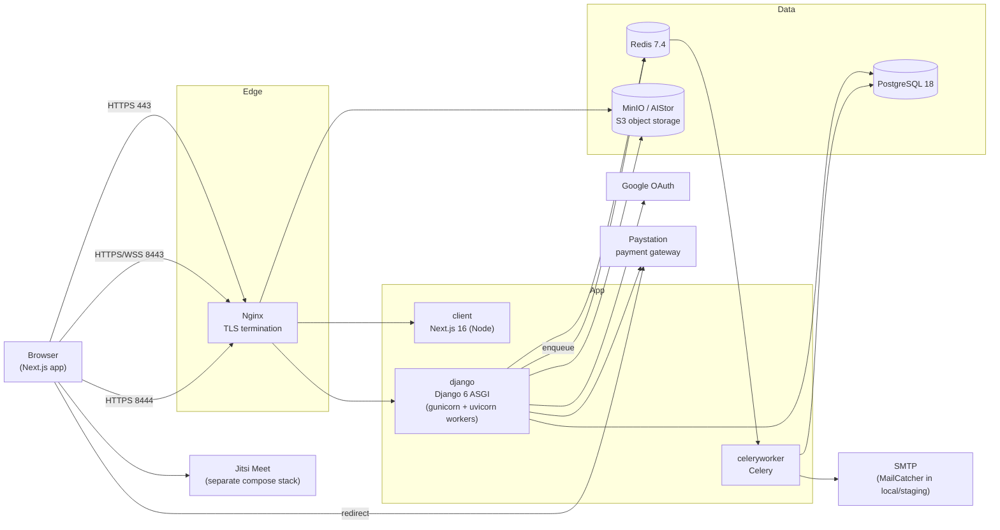
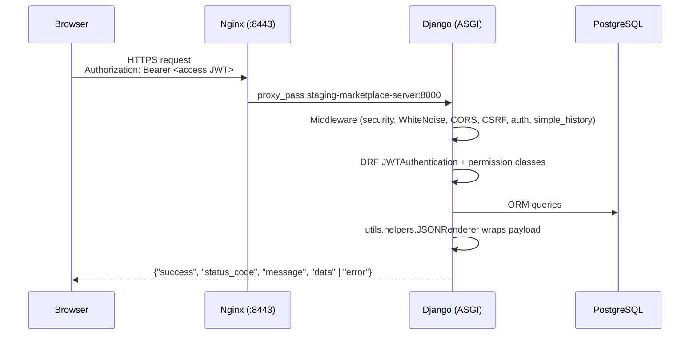
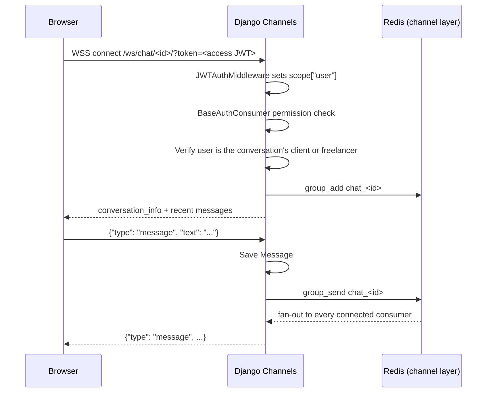
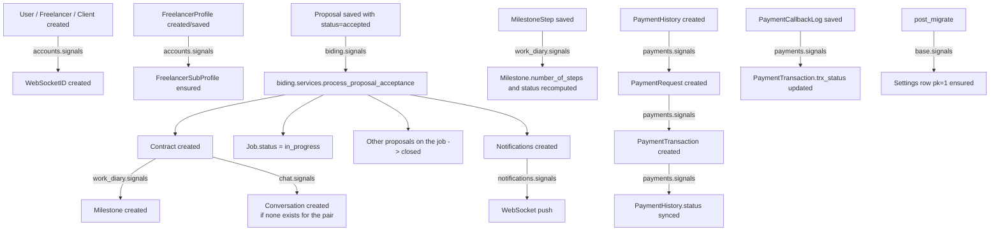
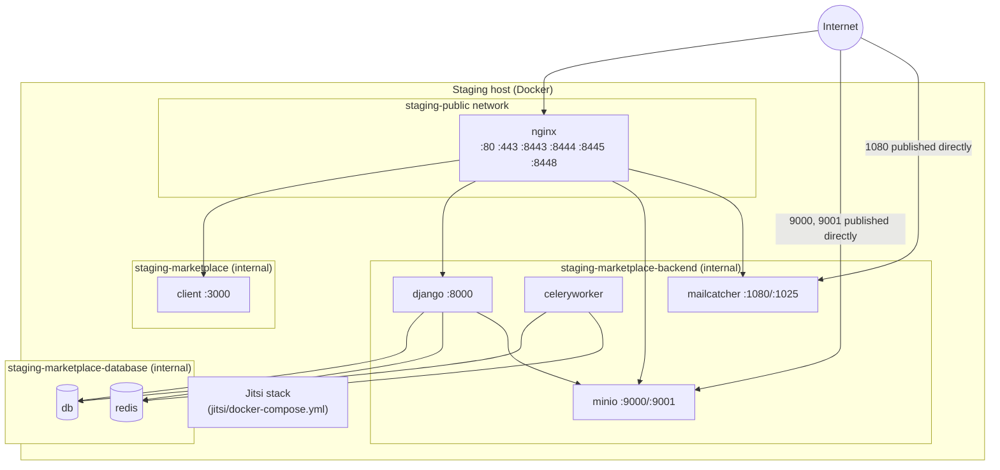

# Architecture

This document describes how the Marketplace system is put together. Everything here is
derived from the source code and deployment files in this repository unless marked
otherwise.

- [System overview](#system-overview)
- [Components](#components)
- [Request lifecycles](#request-lifecycles)
- [Real-time (WebSocket) flow](#real-time-websocket-flow)
- [Background processing](#background-processing)
- [Event-driven side effects (Django signals)](#event-driven-side-effects-django-signals)
- [External integrations](#external-integrations)
- [Deployment topology (staging)](#deployment-topology-staging)
- [Design characteristics and constraints](#design-characteristics-and-constraints)

## System overview

Marketplace is a freelance marketplace for university students. Students register as
**freelancers** with an email address from an accepted university domain and a student
ID. **Clients** post jobs; freelancers submit **proposals**; a client accepting a
proposal creates a **contract**, which comes with a chat conversation, a milestone plan
(the "work diary") and video meetings.

The system is a classic three-tier web application packaged as Docker containers:

## Components

| Component | Location | Responsibility |
|---|---|---|
| Frontend | [`client/`](../client) | Next.js 16 / React 19 single-page-style app (App Router). Talks to the API over REST (RTK Query) and WebSockets. See [frontend.md](frontend.md). |
| API server | [`server/`](../server) | Django 6 + Django REST Framework + Django Channels. Serves REST endpoints, WebSockets, Django admin and the OpenAPI schema. See [backend.md](backend.md). |
| Celery worker | same image as the API server, started with `/start-celeryworker` | Sends signup-verification and password-reset emails. |
| PostgreSQL | [`database/postgres/`](../database/postgres) | Primary data store. Staging image adds manual `backup` / `restore` scripts. |
| Redis | [`database/redis/`](../database/redis) | Celery broker (db 0) and result backend (db 1) in the example config; Django Channels layer. |
| MinIO (AIStor) | [`minio/`](../minio) | S3-compatible storage for all uploaded files (Django `default` storage) and, outside local, static files. |
| Nginx | [`nginx/`](../nginx) | Staging-only reverse proxy and TLS termination. Configs are templates rendered with `SERVER_NAME` at container start. |
| MailCatcher | `sj26/mailcatcher` image | Captures outgoing SMTP mail in local and staging. |
| Jitsi Meet | [`jitsi/`](../jitsi) | Vendored copy of the upstream `docker-jitsi-meet` project, deployed as its own compose stack. The backend only issues JWTs for it. |
| CI/CD | [`Jenkinsfile`](../Jenkinsfile) + `*/pipeline.groovy` | Builds and (re)starts changed services on the staging host. See [deployment.md](deployment.md). |

## Request lifecycles

### REST request

- Authentication is stateless: the frontend stores the access and refresh JWTs in
  browser cookies (set by JavaScript) and sends the access token in the
  `Authorization: Bearer` header. See [security.md](security.md).
- The default DRF permission is `IsAuthenticated`. Public endpoints opt out explicitly.
- Every DRF response goes through a custom renderer that produces a standard envelope.
  See [api.md](api.md#response-envelope).

### Page request

The browser loads the Next.js app from the `client` container (port 443 behind Nginx).
Pages are client components; data is fetched from the API directly by the browser using
`NEXT_PUBLIC_API_URL`. `client/src/proxy.ts` (Next.js "proxy", formerly middleware) is
currently a pass-through and does **not** enforce authentication; route protection is done
in client components (see [frontend.md](frontend.md#authentication-handling)).

## Real-time (WebSocket) flow

Django Channels serves two WebSocket routes (`server/src/config/routing.py`):

| Route | Consumer | Purpose |
|---|---|---|
| `ws/notification/<notification_id>/` | `notifications.consumers.NotificationConsumer` | Pushes the user's latest notifications. `notification_id` is the user's `WebSocketID.notification_id`. |
| `ws/chat/<conversation_id>/` | `chat.consumers.ChatConsumer` | Real-time chat for one conversation (messages, typing indicators, read receipts). |

The JWT is passed as a `token` query parameter because browsers cannot set headers on
WebSocket requests (`client/src/lib/websocketUrl.ts`). An `Authorization` header is also
accepted by `server/src/config/middleware.py`.

Notifications are pushed from a `post_save` signal on `Notification`
(`server/src/notifications/signals.py`): each new notification triggers a `group_send` of
the user's first page of notifications to the group `notification_<notification_id>`.

## Background processing

Celery is configured in `server/src/config/celery.py` and `config/settings/celery.py`.
Verified tasks (`server/src/accounts/tasks.py`):

| Task | Triggered by | Effect |
|---|---|---|
| `send_signup_verification_email_task` | Email/password sign-up (freelancer or client) | Sends a plain-text email with a verification link to `<frontend_url>/email-verified/<uid>/<token>`. |
| `send_reset_mail_task` | `POST /accounts/password-reset-mail/` | Sends a plain-text email with a 6-character reset code. |

There are no scheduled (beat) tasks in the repository. The staging worker runs with
`--pool=solo --concurrency=1` to minimise memory use
(`server/compose/staging/django/celery/worker/start`).

## Event-driven side effects (Django signals)

A large part of the business logic runs in `post_save` / `pre_save` signal handlers.
Developers changing a model should check these first.

## External integrations

| Integration | Where | Notes |
|---|---|---|
| Google OAuth 2.0 | `server/src/accounts/helpers.py` (`google_user_details`), `client/src/lib/googleOAuth.ts` | Authorization-code flow. The browser obtains a `code`; the backend exchanges it using `google_credentials.json` and verifies the ID token. |
| Paystation | `server/src/payments/utils.py`, `server/src/config/paystation.py` | Initiate-payment and transaction-status APIs. `PAYSTATION_ENV` selects sandbox or live URLs. |
| Jitsi Meet | `server/src/meeting/jitsi.py`, `client/src/app/meeting/[room_name]/page.tsx` | Backend signs an HS256 JWT with `JITSI_APP_SECRET`; the frontend embeds the meeting with `@jitsi/react-sdk`. |
| S3 (MinIO) | `server/src/config/settings/storage.py` | `django-storages` `S3Boto3Storage` for media and static files. |
| SMTP | `EMAIL_*` settings | MailCatcher in local/staging compose; real SMTP server for any other environment. |

## Deployment topology (staging)

The only deployment described in this repository is the **staging** stack
(`compose.staging.yaml`), deployed by Jenkins. A production settings module
(`server/src/config/settings/prod.py`) exists but no production compose file or pipeline
uses it. See [deployment.md](deployment.md).

Port map (Nginx, `nginx/templates/staging/`):

| Public port | Upstream | Purpose |
|---|---|---|
| 80 | – | Redirects to HTTPS 443; `/health` returns `200 healthy` |
| 443 | `client:3000` | Frontend |
| 8443 | `django:8000` | REST API, WebSockets, Django admin, OpenAPI |
| 8444 | `minio:9000` | S3 API (file downloads/uploads), 1 GB body limit |
| 8445 | `minio:9001` | MinIO console |
| 8448 | `mailcatcher:1080` | MailCatcher web UI |

`server.conf.template` also defines an HTTP listener on 8080 that redirects to 8443, but
port 8080 is not published in `compose.staging.yaml`.

## Design characteristics and constraints

- **Role model**: one `User` table with a `role` field and Django proxy models
  (`Client`, `Freelancer`, `Arbitrator`, `Auditor`). Profiles hang off the user
  (`ClientProfile`, `FreelancerProfile` → `FreelancerSubProfile`). Only `client`,
  `freelancer` and `admin` are used by application logic; `arbitrator` and `auditor`
  exist only as model definitions.
- **UUID primary keys** for users, jobs, proposals, contracts, milestones, payments and
  meetings, assigned in each model's `save()`.
- **Audit history**: most models use `django-simple-history` (`history = HistoricalRecords()`),
  exposed through Django admin and the `history` action of the admin API.
- **Runtime settings in the database**: `base.Settings` (single row, `pk=1`) holds the
  frontend URL, backend URL, OTP timeout and email-verification timeout. These are read
  on every use, not from environment variables. See [configuration.md](configuration.md#database-stored-settings).
- **No automated tests** exist yet. See [development.md](development.md#testing-and-quality).
