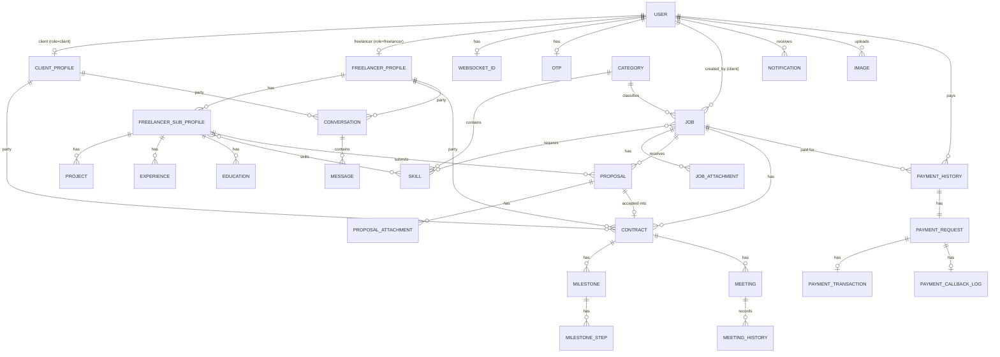

# Data Model

Database: **PostgreSQL 18** (Docker image `postgres:18`), accessed via the Django ORM with
`psycopg2`. The model classes and migrations under `server/src/<app>/` are the source of
truth; this document summarises them. `django.contrib.postgres` is installed and
`Job.tags` uses a PostgreSQL `ArrayField`.

- [Entity–relationship overview](#entityrelationship-overview)
- [Accounts](#accounts)
- [Jobs](#jobs)
- [Bidding and contracts](#bidding-and-contracts)
- [Work diary](#work-diary)
- [Payments](#payments)
- [Chat, notifications, meetings, images](#chat-notifications-meetings-images)
- [Application settings](#application-settings)
- [History tables](#history-tables)
- [Migrations](#migrations)
- [Deletion behaviour](#deletion-behaviour)

## Entity–relationship overview

In practice each contract has exactly one milestone (created by a signal), and a
conversation is unique per client–freelancer pair by application logic (not a database
constraint).

## Accounts

Defined in `server/src/accounts/models/`.

### `User` (`accounts_user`, `AUTH_USER_MODEL`)

Extends Django `AbstractUser`.

| Field | Type | Notes |
|---|---|---|
| `id` | UUID | Primary key, set in `save()`. |
| `email` | email | Unique; `USERNAME_FIELD`. |
| `username` | string | Unique (Django default); `REQUIRED_FIELDS`. |
| `first_name`, `last_name` | string | |
| `phone` | string(20) | Optional. |
| `sub` | string(100) | Google user ID; unique, nullable. |
| `is_google_login` | bool | |
| `email_verified` | bool | Sign-in requires `True`. |
| `is_resent_email` | bool | Whether a verification email has been re-sent. |
| `role` | `client` / `freelancer` / `admin` / `arbitrator` / `auditor` | Default `freelancer`. |
| `is_active`, `is_staff`, `is_superuser`, `password`, `last_login`, `date_joined` | | Django defaults. |

Proxy models (same table): `Client`, `Freelancer`, `Arbitrator`, `Auditor`, each with a
manager filtered by `role`.

### Profiles

| Model | Key fields | Relations |
|---|---|---|
| `ClientProfile` | `company_name`, `is_payment_verified`, `is_phone_verified`, `twitter`, `linkedin`, `bio`, `avatar` (URL) | One-to-one `client` → `User` |
| `FreelancerProfile` | `student_id` (unique, 20), `is_available`, `avatar` (URL), `available_connects` (default 30, unused) | One-to-one `freelancer` → `User` |
| `FreelancerSubProfile` | `hours_per_week`, `is_more_available`, `hour_rate` (decimal 10,2; must not be negative), `bio`, `linkedin`, `twitter`, `github`, `portfolio` | FK `freelancer_profile`; M2M `skills` → `jobs.Skill` |
| `Project` | `title`, `link`, `description` | FK `sub_profile` |
| `Experience` | `job_title`, `company_name`, `start_date`, `end_date`, `is_present`, `description` | FK `sub_profile` |
| `Education` | `institution_name`, `degree`, `start_date`, `end_date`, `area_of_study`, `description` | FK `sub_profile` |

### Other account models

| Model | Purpose |
|---|---|
| `AcceptedDomain` | `domain` (unique), `is_active`, `notes`. Email domains allowed for freelancer sign-up and Google sign-up. |
| `OTP` | One per user (`OneToOne`). `code` is regenerated on every save (6 uppercase hex characters from a UUID). Used for password reset. |
| `WebSocketID` | One per user. `notification_id` (unique, 32 hex characters) identifies the user's notification WebSocket group. |

`accounts/models/connects/` also defines `ConnectUsage` and `ConnectHistory`, but they are
not imported into `accounts.models`, so Django does not register them: they have no
migrations and no tables.

## Jobs

`server/src/jobs/models/`.

| Model | Key fields | Notes |
|---|---|---|
| `Category` | `name` (unique), `slug` (unique, auto) | Ordered by name. |
| `Skill` | `name` (unique), `slug` (unique, auto), `description` | FK `category`. |
| `Job` | `id` (UUID), `title`, `description`, `tags` (array of string(50)), `min_budget`, `max_budget`, `is_fixed`, `min_hourly_rate`, `max_hourly_rate`, `duration` (free text), `experience_level` (`entry`/`intermediate`/`expert`), `min_proposal_count`, `max_proposal_count`, `status` (`draft`/`open`/`closed`/`in_progress`/`completed`), `connect` (default 1), `privacy` (`public`/`private`), timestamps | FK `category`, FK `created_by` → `Client`, M2M `skills`. Ordered newest first. Manager: `published()`, `open()`. |
| `Attachment` | `file` (max 2 MB), `uploaded_at` | FK `job`. |

## Bidding and contracts

`server/src/biding/models/`.

| Model | Key fields | Notes |
|---|---|---|
| `Proposal` | `id` (UUID), `cover_letter`, `bid_amount` (decimal 10,2), `used_connects`, `status` (`pending`/`reviewed`/`accepted`/`closed`/`rejected`), `submitted_at` | FK `freelancer_sub_profile`, FK `job`. `save()` sets `bid_amount = job.min_budget` for fixed-price jobs. No uniqueness constraint per freelancer and job. |
| `Attachment` | `id` (UUID), `file` | FK `proposal`. |
| `Contract` | `id` (UUID), `budget`, `start_date` (auto), `end_date`, `status` (`active`/`completed`/`cancelled`) | FKs `freelancer_profile`, `freelancer_sub_profile`, `client_profile`, `job`; one-to-one `proposal`. Manager: `active()`. |

## Work diary

`server/src/work_diary/models/milestone.py`.

| Model | Key fields | Notes |
|---|---|---|
| `Milestone` | `id` (UUID), `number_of_steps`, `status` (`pending`/`active`/`completed`/`cancelled`) | FK `contract`. Status and step count are recalculated by a signal. |
| `MilestoneStep` | `id` (UUID), `step_number`, `title`, `description`, `amount` (decimal 12,2), `start_date`, `due_date`, `message`, `code_zip` (file), `uploaded_at`, `status` (`pending`/`submitted`/`in_review`/`accepted`/`rejected`/`paid`) | FK `milestone`. Ordered by `step_number`. `step_number` is not unique at database level. |

## Payments

`server/src/payments/models/`. A payment creates one row in each table through signals.

| Model | Key fields | Notes |
|---|---|---|
| `PaymentHistory` | `id`, `amount`, `currency` (default `BDT`), `status` (`PROCESSING`/`SUCCESS`/`FAILED`/`CANCELED`/`REFUND`) | FK `job`, FK `user`. Status mirrors the transaction. |
| `PaymentRequest` | `id`, `invoice_number` (unique, 10-char base62), `reference`, `checkout_items`, `opt_a/b/c`, gateway response fields (`status_code`, `status` `CREATED`/`SUCCESS`/`FAILED`, `message`, `payment_url`, `payment_url_expiry`) | One-to-one `payment_history`. |
| `PaymentTransaction` | `id`, `trx_status`, `trx_id` (unique), `payment_amount`, `order_date_time`, `payer_mobile_no`, `payment_method`, `trx_amount`, `trx_date`, `is_verified` | One-to-one `payment_request` (`PROTECT`). |
| `PaymentCallbackLog` | `id`, `trx_id`, `status` (`SUCCESSFUL`/`FAILED`/`CANCELED`), `message`, `received_at` | One-to-one `payment_request`. Only the first callback per request is stored. |

## Chat, notifications, meetings, images

| Model | Key fields | Notes |
|---|---|---|
| `chat.Conversation` | `conversation_id` (unique 32-hex, auto), `status` (`active`/`inactive`/`closed`/`archived`/`deleted`), `created_at` | FKs `freelancer_profile`, `client_profile`. |
| `chat.Message` | `text`, `timestamp`, `is_read`, `seen_by_freelancer_at`, `seen_by_client_at` | FK `conversation`; sender is either `freelancer_profile` or `client_profile` (one must be set; `SET_NULL` on delete). |
| `notifications.Notification` | `message_type` (`alert`/`warning`/`error`/`info`/`success`), `message`, `is_read`, `created_at` | FK `user`. |
| `meeting.Meeting` | `id` (UUID), `room_name` (unique, 10 chars, auto), `topic`, `duration` (minutes), `start_date`, `start_time`, timestamps | FK `contract`. |
| `meeting.MeetingHistory` | `joined_at`, `left_at` | FK `meeting`, FK `user`. `left_at` is an `auto_now` field, so it equals the last save time, not an actual leave time. |
| `images.Image` | `id` (UUID), `image`, timestamps | FK `uploaded_by`. Deleting the row deletes the stored file. |

## Application settings

`base.Settings` (`base_settings`) is a single-row table (`pk=1`), created automatically after
migrations. See [configuration.md](configuration.md#database-stored-settings).

| Field | Default | Used by |
|---|---|---|
| `otp_timeout` | 300 (seconds) | Password-reset code expiry. |
| `email_verify_timeout` | 120 (seconds) | Email verification link expiry. |
| `frontend_url` | `http://localhost:3000` | Links in emails, payment redirect, proposal `job_link`. |
| `backend_url` | `http://localhost:8000` | Paystation callback URL. |

## History tables

Most models declare `history = HistoricalRecords()` (django-simple-history), creating a
`historical<model>` table per model that records every change with user, timestamp and
type. `simple_history.middleware.HistoryRequestMiddleware` attributes changes to the
request user. History is visible in Django admin and via `GET /admin-api/<resource>/<id>/history/`.
Models without history: `Notification`, `Conversation`, `Message`, `Image`, `WebSocketID`.

## Migrations

- Migrations live in each app's `migrations/` folder (52 files in total at the time of writing).
- They run automatically on container start: both `server/compose/*/django/start` scripts
  execute `python manage.py migrate` before starting the server.
- Developers create migrations with `python manage.py makemigrations` (or `make migrate`,
  which runs both `makemigrations` and `migrate` inside the `django` container).
- Note that `make server` and `make update-database` also run `makemigrations`; review
  generated files before committing.
- There is no documented rollback strategy; Django migrations can be reversed with
  `python manage.py migrate <app> <previous_migration>` where operations are reversible.

## Deletion behaviour

Most foreign keys use `CASCADE`. Important consequences:

- Deleting a `User` deletes their profiles, jobs, proposals, contracts, conversations,
  notifications and images.
- Deleting a `FreelancerSubProfile` deletes its proposals **and** contracts (and, through
  them, milestones and meetings).
- Deleting a `Job` deletes its proposals and contracts.
- `PaymentTransaction.payment_request` is `PROTECT`. Because every payment request gets a
  transaction, deleting anything that cascades to a `PaymentRequest` (a job or user with
  payment history, or the history row itself) raises `ProtectedError` and is refused
  (inferred from the model definitions; not tested).
- Chat messages keep existing when a sender profile is deleted (`SET_NULL`).

Backup and restore procedures are described in [deployment.md](deployment.md#database-backup-and-restore).
