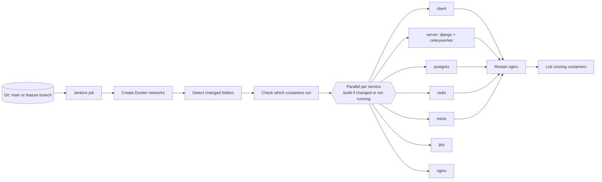

# Deployment and Operations

This repository defines one deployed environment: **staging**, built from
`compose.staging.yaml` on a single Docker host and driven by Jenkins. The public host name
is supplied through `SERVER_NAME` (it is not stored in the repository).

A `production` Django settings module exists (`server/src/config/settings/prod.py`), but
there is no production compose file, pipeline or documented procedure. Any production
deployment outside this repository **requires project-owner confirmation** before it is
documented here.

- [Overview](#overview)
- [Host prerequisites](#host-prerequisites)
- [Jenkins pipeline](#jenkins-pipeline)
- [Service start-up](#service-start-up)
- [Health checks](#health-checks)
- [Logs](#logs)
- [Database backup and restore](#database-backup-and-restore)
- [Rollback](#rollback)
- [Post-deployment checklist](#post-deployment-checklist)
- [Operational notes and limits](#operational-notes-and-limits)

## Overview



Each service has its own `pipeline.groovy` next to its compose files. Every service
pipeline decrypts its secrets with GPG, then runs
`docker compose -f compose.staging.yaml up --build -d <service>` (Jitsi uses its own
compose file).

## Host prerequisites

Verified from the pipeline scripts; host provisioning itself is not in the repository.

- Docker Engine with Compose v2 and BuildKit; Jenkins agent able to run `docker`.
- `gpg` available to the Jenkins agent.
- Jenkins credentials: `gpg-private-key` (secret file) and `gpg-passphrase` (secret text).
- Jenkins environment variable **`SERVER_NAME`** (public host name), used by Nginx.
- A TLS certificate and key for that host, committed encrypted as `ssl/server.crt.gpg`
  and `ssl/server.key.gpg`.
- Inbound ports: 80, 443, 8443, 8444, 8445, 8448 (Nginx), plus 9000, 9001 (MinIO) and
  1080 (MailCatcher), which `compose.staging.yaml` also publishes directly, and the Jitsi
  ports configured in `jitsi/.env`.
- MinIO data directory `${HOME}/minio/data` on the host (home of the user running Compose).

## Jenkins pipeline

`Jenkinsfile` stages:

| Stage | What it does |
|---|---|
| Checkout | `checkout scm`. |
| Create Docker Networks | Creates, if missing: `staging-marketplace-database` (internal), `staging-marketplace-backend` (internal), `staging-marketplace` (internal), `staging-public`. |
| Detect Changes | On `main`: files changed between `HEAD~1` and `HEAD`. On other branches: files changed since the merge base with `origin/main`. |
| Check Service Status | For each service, marks it for build if its container is not running **or** files under its folder changed. |
| Run Services (parallel) | Runs each marked service's `pipeline.groovy`. |
| Restart NGINX After Changes | If client, server, Postgres, Redis or MinIO was built, restarts the Nginx container and waits up to 30 s. |
| Verify Deployment | Prints `docker ps` for `staging` and `jitsi` containers. |

Service folders used for change detection:

| Service | Folder | Container | Pipeline |
|---|---|---|---|
| Client | `client/` | `staging-marketplace-client` | `client/compose/staging/pipeline.groovy` |
| Server | `server/` | `staging-marketplace-server` (+ `staging-marketplace-celeryworker`) | `server/compose/staging/pipeline.groovy` |
| Postgres | `database/postgres/compose/staging/` | `staging-marketplace-db` | `database/postgres/compose/staging/pipeline.groovy` |
| Redis | `database/redis/compose/staging/` | `staging-marketplace-redis` | `database/redis/compose/staging/pipeline.groovy` |
| MinIO | `minio/staging/` | `staging-aistor-server` | `minio/staging/pipeline.groovy` |
| Jitsi | `jitsi/` | `jitsi-web-1` | `jitsi/compose/staging/pipeline.groovy` |
| Nginx | `nginx/` | `staging-marketplace-nginx` | `nginx/compose/staging/pipeline.groovy` |

Consequences to be aware of:

- On `main`, only the **last commit** is diffed. If several commits are pushed at once,
  changes in earlier commits are not detected (unless the container is not running).
- Changes to `compose.staging.yaml`, `Jenkinsfile` or `ssl/` alone do not trigger any
  service rebuild. After changing the certificate, the Nginx and Jitsi pipelines must be
  re-run (for example by stopping the containers, or by touching a file in their folder).
- Feature-branch builds deploy to the **same** staging containers as `main`.

Per-service pipeline steps:

| Pipeline | Steps |
|---|---|
| Server | Decrypt `.env` and `google_credentials.json` → `up --build -d django celeryworker` → wait up to 60 s for the server health check. |
| Client | Decrypt `.env` → `up --build -d client` (the env file is baked into the build). |
| Postgres | Decrypt `.env` → `up --build -d db` → wait for health. |
| Redis | Decrypt `.env` → `up --build -d redis` → wait for health. |
| MinIO | Decrypt `.env` and license → `up --build -d minio` → wait for running/healthy (`mc ready local`). |
| Nginx | Decrypt TLS certificate and key into `ssl/` → check `SERVER_NAME` is set → build a temporary image and run `nginx -t` with the templates rendered → create `nginx/logs` → `up --build -d nginx` → wait for running/healthy. |
| Jitsi | Decrypt `jitsi/.env` and copy the TLS certificate and key into `jitsi/web/keys/` → `docker compose -f jitsi/docker-compose.yml --env-file jitsi/.env up --build -d` → check web and prosody containers. |

## Service start-up

| Service | Start command | Notes |
|---|---|---|
| django | `/start`: `python manage.py migrate`, then `gunicorn config.asgi:application --workers 4 --worker-class uvicorn.workers.UvicornWorker --bind 0.0.0.0:8000 --proxy-protocol --forwarded-allow-ips='*'` | **Migrations run automatically on every start.** |
| celeryworker | `celery -A config.celery worker --pool=solo --concurrency=1 --prefetch-multiplier=1 --max-tasks-per-child=50 --max-memory-per-child=100000 --loglevel=WARNING --without-gossip --without-mingle --without-heartbeat` | Memory limit 256 MB (reservation 128 MB). |
| client | `node .next/standalone/server.js` | Runs as user `node`. |
| db | Postgres 18 entrypoint | Read-only root filesystem; data in volume `staging-db-data`, backups in volume `staging-db-backups`. |
| redis | Default `redis:7.4` command | Data in volume `staging-redis-data`. The staging service has no custom command (no AOF options, unlike local). |
| minio | `minio server /data --console-address ":9001"` | |
| nginx | Official image entrypoint renders templates, then `nginx -g 'daemon off;'` | |

Static files: in staging, `STORAGES["staticfiles"]` points at MinIO (`static/` prefix), but
no step runs `collectstatic`. Django admin and Swagger UI assets may therefore be missing
unless `collectstatic` has been run manually (**not verified**):

```bash
docker exec staging-marketplace-server python manage.py collectstatic --noinput
```

`restart: unless-stopped` is set for nginx, minio and mailcatcher only. django,
celeryworker, client, db and redis have no restart policy in `compose.staging.yaml`, so
they do not restart automatically after a host reboot or crash.

## Health checks

| Container | Check | Interval |
|---|---|---|
| django | `GET http://127.0.0.1:8000/health_check/` (Python urllib) | 10 s, 40 s start period |
| celeryworker | `celery -A config inspect ping` | 30 s |
| client | `wget --spider http://localhost:3000/` | 30 s |
| db | `pg_isready` | 10 s |
| redis | `redis-cli ping` | 10 s |
| mailcatcher | `wget --spider http://0.0.0.0:1080` | 10 s |

The django health check only proves the process answers HTTP; it does not check the
database, Redis or storage. Nginx serves `GET /health` on port 80 (static `200 healthy`).
No external monitoring or alerting is configured in the repository.

## Logs

| Source | Location |
|---|---|
| Nginx access/error logs | `nginx/logs/staging/` on the host (per-service files: `client_*`, `server_*`, `minio_api_*`, `minio_console_*`, `mailcatcher_*`). Container logs are rotated at 10 MB × 3. |
| Django, Celery, client, others | `docker logs <container>` (Docker default json-file driver; no rotation configured except Nginx). |
| Payment gateway issues | Logged by `payments.utils` with Python `logging` (warning/error) to the container output. No `LOGGING` setting is defined, so Django defaults apply. |

## Database backup and restore

The staging Postgres image includes maintenance scripts from
`database/postgres/compose/staging/maintenance/`, installed on the image `PATH`. Backups
are written to `/backups` (the `staging-db-backups` volume) as
`staging-db-backup_<YYYY_MM_DDTHH_MM_SS>.sql.gz`.

There is **no scheduled backup**. Run them manually (commands derived from the scripts,
**not executed** while writing this guide):

```bash
# Create a backup
docker compose -f compose.staging.yaml exec db backup

# List backups
docker compose -f compose.staging.yaml exec db backups

# Restore (drops and recreates the database!)
docker compose -f compose.staging.yaml stop django celeryworker
docker compose -f compose.staging.yaml exec db restore staging-db-backup_<timestamp>.sql.gz
docker compose -f compose.staging.yaml start django celeryworker

# Remove a backup
docker compose -f compose.staging.yaml exec db rmbackup staging-db-backup_<timestamp>.sql.gz
```

Notes:
- The scripts' usage text says `postgres`; the Compose service is called **`db`**.
- They connect using `POSTGRES_HOST`, `POSTGRES_PORT`, `POSTGRES_USER`,
  `POSTGRES_PASSWORD`, `POSTGRES_DB` from the container environment; `POSTGRES_HOST` must
  resolve inside the container (for example `localhost`). The encrypted staging env was
  not inspected, so whether it is set correctly **requires confirmation**.
- `backup` refuses to run when `POSTGRES_USER` is `postgres`.
- Backups stay on the same host volume. Copy them off the host for real disaster recovery:
  `docker cp staging-marketplace-db:/backups/<file> .`
- MinIO data (`${HOME}/minio/data`) and Redis data are not covered by these scripts.

## Rollback

No automated rollback exists. Images are rebuilt in place with fixed tags
(`staging-marketplace-server`, etc.), so the previous image is not kept under a name.
The practical procedure is:

1. Revert the offending commit on `main` (`git revert`) and push, so Jenkins rebuilds the
   affected service. Because only `HEAD~1..HEAD` is diffed, the revert commit must touch
   the same service folder (it will, since it reverses those files).
2. If a migration ran, reverting code does **not** reverse it. Restore from a backup taken
   before the deployment, or write and apply a reversing migration.

Recommended improvement, not currently implemented: take a database backup automatically
before deploying the server, and tag images per commit.

## Post-deployment checklist

After the first deployment, or after resetting the database:

1. Create a superuser: `docker exec -it staging-marketplace-server python manage.py createsuperuser`.
2. In Django admin → **Settings**, set Frontend URL to `https://<public-host>` and Backend
   URL to `https://<public-host>:8443` (used for email links and the Paystation callback).
3. Add the allowed university email domains under **Accepted Domains**.
4. Make sure the storage bucket exists in MinIO (console on port 8445).
5. Verify Google OAuth redirect URIs, Jitsi JWT settings and Paystation environment
   (see [configuration.md](configuration.md)).

## Operational notes and limits

- **Single host**: every service, including the database, runs on one Docker host. There
  is no replication, load balancing or horizontal scaling configuration.
- **Gunicorn** runs 4 uvicorn workers. Channels uses Redis, so WebSockets work across
  workers.
- **Celery** processes one task at a time; email sending is the only workload.
- **Email** in staging goes to MailCatcher unless the encrypted server env points to a real
  SMTP server (not inspected). MailCatcher's UI is published on ports 1080 and 8448.
- **DEBUG** is forced to `true` for the staging django and celeryworker containers by
  `compose.staging.yaml`.
- **Time zone**: Django and Celery use UTC; Nginx containers use `Asia/Dhaka`.
- Troubleshooting procedures are in [troubleshooting.md](troubleshooting.md).
