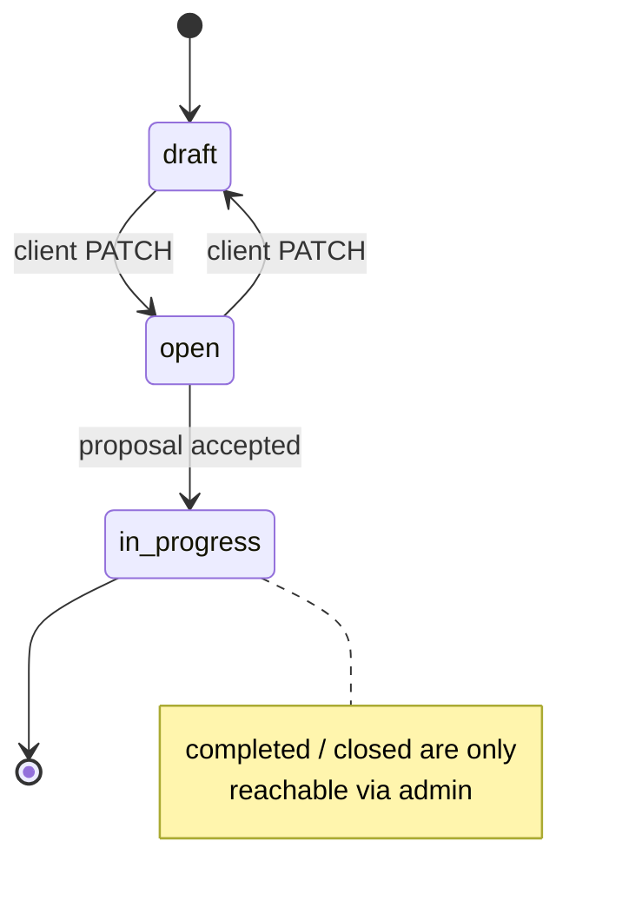
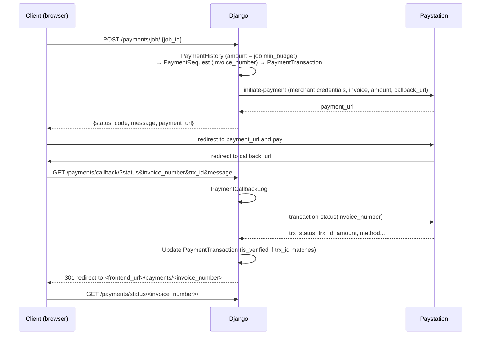

# Features and Business Rules

Each section traces a feature to its implementation. "Verified" statements come from
reading the code; nothing here was tested against a running system. Defects and gaps are
collected in [known-issues.md](known-issues.md); this document links to them where
relevant.

- [Roles](#roles)
- [Registration and email verification](#registration-and-email-verification)
- [Sign-in, sign-out and password reset](#sign-in-sign-out-and-password-reset)
- [Profiles](#profiles)
- [Jobs](#jobs)
- [Proposals (bids)](#proposals-bids)
- [Contracts](#contracts)
- [Milestones (work diary)](#milestones-work-diary)
- [Payments](#payments)
- [Chat](#chat)
- [Notifications](#notifications)
- [Meetings](#meetings)
- [Image uploads](#image-uploads)
- [Administration](#administration)
- [Not implemented](#not-implemented)

## Roles

`User.role` (`accounts/models/user/base.py`):

| Role | How it is created | Capabilities |
|---|---|---|
| `freelancer` (default) | `/accounts/signup/`, `/accounts/signup-google/`, seed data | Browse jobs, submit proposals, work on contracts, chat, join meetings. |
| `client` | `/accounts/clients/signup/`, `/accounts/clients/signup-google/`, seed data | Post and manage jobs, review and accept proposals, manage milestones, schedule meetings, pay for jobs, chat. |
| `admin` | `createsuperuser` (forces `role=admin`), seed `super_admins.json` | Django admin and `/admin-api/` (requires `is_staff` plus model permissions). |
| `arbitrator`, `auditor` | Only via admin | Defined as proxy models; no application logic uses them. |

## Registration and email verification

**Freelancer (email/password)** — `accounts/serializers/freelancers/signup.py`
- Required fields: `first_name`, `last_name`, `email`, `phone`, `username`, `password`,
  `confirm_password`, `student_id`.
- The email's domain must be in the active **Accepted Domains** list (admin-managed;
  public list at `GET /accounts/accepted-domain/`). Error: *"Try with your varsity mail
  address"*.
- `student_id`, email and username must be unique; passwords must match.
- Creates an inactive user (`is_active=False`) and a `FreelancerProfile`; a
  `FreelancerSubProfile` and `WebSocketID` are created by signals. A verification email is
  queued on Celery.

**Client (email/password)** — `accounts/serializers/clients/signup.py`
- Same fields minus `student_id`, plus optional `company_name`. **No domain restriction.**
- Creates an inactive user and a `ClientProfile`, and queues a verification email.

**Email verification** — `accounts/views/email_verify.py`
- The email links to `<frontend_url>/email-verified/<uidb64>/<token>`; the page calls
  `GET /accounts/verify/email/<uidb64>/<token>/`.
- The token is a Django password-reset-style token (`accounts/tokens.py`). It expires after
  `Settings.email_verify_timeout` seconds (**default 120 seconds**, editable in Django admin).
- On success the user becomes active and `email_verified=True`. An expired link returns
  `is_expired: true`; `GET /accounts/resend/email/<uidb64>/<token>/` resends a link.

**Google sign-up** — `accounts/serializers/{freelancers,clients}/signup_google.py`
- The frontend obtains an OAuth `code`; the backend exchanges it, reads the verified
  email and Google `sub`, and requires the email domain to be an accepted domain
  (for both roles). Username = local part of the email; password is random.
- Client Google sign-up requires a `student_id` field in the request but does not store it.
- Google sign-up does **not** create a `FreelancerProfile`/`ClientProfile`
  (see [known-issues.md](known-issues.md#accounts)).
- Returns access and refresh tokens immediately.

## Sign-in, sign-out and password reset

| Flow | Endpoint | Rules |
|---|---|---|
| Email sign-in | `POST /accounts/signin/` | Email + password; fails if the email is not verified. Returns `access`, `refresh`. |
| Google sign-in | `POST /accounts/signin-google/` | Finds a user with the same email **and** Google `sub`; returns `access`, `refresh`, `role`. |
| Token refresh | `POST /accounts/token/refresh/` | SimpleJWT; refresh tokens rotate and old ones are blacklisted. |
| Token verify | `POST /accounts/token/verify/` | SimpleJWT. |
| Sign-out | `POST /accounts/logout/` | Blacklists the given refresh token. The frontend does not call it. |
| Change password | `PUT /accounts/password-change/` | Requires `old_password`; new and confirm must match. |
| Request reset | `POST /accounts/password-reset-mail/` | Creates a 6-character code (`OTP`) and emails it. If an unexpired code exists, nothing is sent and the response says the mail was already sent. |
| Verify code | `POST /accounts/otp-verify/` | Checks the code for the email and its age against `Settings.otp_timeout` (default 300 s). |
| Reset | `POST /accounts/password-reset/` | Email + code + new password + confirmation. |

Access token lifetime is 5 minutes in `base` settings and 30 days in `local` and `staging`.
Refresh tokens use the SimpleJWT default (1 day).

## Profiles

- **Own profile**: `GET/PATCH /accounts/info/` (freelancer) and
  `GET/PATCH /accounts/clients/info/` (client). Email and role are read-only.
- Freelancer profile includes `is_available`, `avatar` and a list of
  `freelancer_sub_profiles` (hourly rate, hours per week, bio, links, skills, projects,
  experiences, educations). When a PATCH includes `freelancer_sub_profiles`, any existing
  sub-profile whose `id` is not in the list is **deleted**, together with its proposals and
  contracts (see [known-issues.md](known-issues.md#accounts)).
- Client profile includes company name, bio, social links, avatar, and read-only
  `is_payment_verified` / `is_phone_verified` flags (only changeable by admins).
- **Other users**: `GET /accounts/info/<username>/` (authenticated).
- Each profile response contains `notification_id`, which the frontend uses for the
  notification WebSocket.

## Jobs

Model: `jobs/models/job.py`. Statuses: `draft`, `open`, `in_progress`, `completed`, `closed`.

- **Create**: `POST /jobs/create/` (client). Fields: title, description, tags, category,
  skills, min/max budget, `is_fixed`, duration, experience level, min/max proposal count,
  status.
- **Validation** (`jobs/serializers/client/job.py`): `min_budget > 0`,
  `min_budget ≤ max_budget`, `min_proposal_count > 0`, `min ≤ max proposal count`.
  For a draft or open job, every PATCH must include `status` with value `draft` or `open`;
  jobs that are in progress, completed or closed cannot be modified by the client.
- **Client management**: `GET /jobs/my-jobs/`, `GET/PATCH/DELETE /jobs/my-jobs/<id>/`
  with filters (status, category, experience level, budget, hourly rate, skills, tags).
- **Public board**: `GET /jobs/` and `GET /jobs/<id>/` (no authentication) list jobs with
  status `open`, `in_progress`, `completed` or `closed` (drafts hidden). Filters: status,
  category, experience level, budget, skills, tags, and `search` (title, description, tags,
  category, skills, experience level). Page size 10, `page_size` up to 100. Responses include
  `is_applied` for the signed-in freelancer.
- **Reference data**: `GET /jobs/categories-skills/` (public), `GET /jobs/dropdown/`
  (client).
- **Attachments**: `jobs.Attachment` (max 2 MB, `utils/validators.py`) exists but no client
  endpoint creates job attachments; they are managed through the admin API.
- The `privacy` and hourly-rate fields exist on the model but are not exposed by the client
  job serializer and are not used for filtering visibility.

## Proposals (bids)

Model: `biding/models/proposal.py`. Statuses: `pending`, `reviewed`, `accepted`, `closed`,
`rejected`.

- **Submit**: `POST /biding/proposals/` (freelancer, multipart). Fields: `job`,
  `cover_letter`, `bid_amount`, optional `attachments` (list of images).
  - The job must be `open`.
  - For a fixed-price job, `bid_amount` is forced to the job's `min_budget`.
  - Otherwise `bid_amount` must be between the job's `min_budget` and `max_budget`.
  - The proposal is attached to the freelancer's first sub-profile.
- **Freelancer views**: `GET /biding/proposals/` (own), `GET/DELETE /biding/proposals/<id>/`.
- **Client views**: `GET /biding/client/proposals/<job_id>/` lists proposals for a job the
  client owns; `PATCH /biding/client/proposals/update/<proposal_id>/` changes `status`.
  An already accepted proposal cannot be modified.
- Not enforced: one proposal per freelancer per job, `max_proposal_count`, connects
  (see [Not implemented](#not-implemented)).

## Contracts

Model: `biding/models/contract.py`. Statuses: `active`, `completed`, `cancelled`.

When a client sets a proposal to `accepted` (`biding/services.py`), in one transaction:

1. A contract is created with `budget = proposal.bid_amount`.
2. The job becomes `in_progress`.
3. The freelancer gets two notifications ("accepted", "you can chat with the client now").
4. All other proposals for the job become `closed`, and their freelancers are notified.

Signals then create the contract's **milestone** and a **conversation** between the
client and freelancer (reused if one already exists for the pair).

Endpoints: `GET /biding/contracts/` and `/biding/contracts/<id>/` (freelancer),
`GET /biding/client/contracts/`, `/biding/client/contracts/<id>/`,
`/biding/client/contracts/stats/` (client). Contracts never change status through the
API; `completed` and `cancelled` are set only by admins.

## Milestones (work diary)

Models: `work_diary/models/milestone.py`. Each contract has one `Milestone` containing
ordered `MilestoneStep`s.

- Milestone status is computed after every step save: no steps → `pending`; all steps
  `accepted` → `completed`; otherwise `active`.
- Step statuses: `pending`, `submitted`, `in_review`, `accepted`, `rejected`, `paid`.

**Client** (`/work-diary/client/milestones/<contract_id>/…`):
- `GET …/` milestone summary; `GET …/stats/` (path `milestones/stats/`) across contracts.
- `GET/POST …/steps/` list and create steps. `step_number` is auto-assigned when omitted.
- `PATCH …/steps/<step_id>/` edit a step or set its status to `in_review`, `accepted` or
  `rejected` (setting `pending`, `submitted` or `paid` is rejected).
- `POST …/steps/swap/` with `{"a": <step_number>, "b": <step_number>}` swaps order.
- Validation: `start_date` not in the past; `due_date ≥ start_date`; `amount > 0`;
  a single step's amount must be **strictly less** than the contract budget; the sum of
  all step amounts cannot exceed the contract budget; completed contracts cannot be
  modified.
- There is no endpoint to delete a step.

**Freelancer** (`/work-diary/milestones/<contract_id>/…`):
- `GET …/` and `GET …/steps/` read-only views.
- `PATCH …/steps/<step_id>/` uploads `code_zip` and/or a `message`; `uploaded_at` is set.
  The step's status is not changed by an upload.

Nothing in the API sets `submitted` or `paid`, and accepting all steps does not complete
the contract or job.

## Payments

Implemented in `payments/`. Integration with Paystation (BDT).

Rules and behaviour:
- Only the job's owner can pay, and only for a published (non-draft) job.
- The amount is `int(job.min_budget)`; currency `BDT`; `pay_with_charge=1`.
- If Paystation reports a duplicate invoice (`1008`), a new invoice number is generated and
  the request is retried up to 3 times.
- Gateway timeouts and connection errors return 504; invalid JSON returns 502; rejected
  credentials (`1001`) return 502 with a configuration hint and are logged.
- `callback_url` is `Settings.backend_url + /payments/callback/`; the final redirect uses
  `Settings.frontend_url`. Both come from the database `Settings` row.
- **A successful payment updates only the payment records.** It does not mark the client
  as payment-verified or change the job; that code is commented out in
  `payments/signals.py`.

## Chat

- A conversation exists per client–freelancer pair (created when their first contract is
  created). Statuses: `active`, `inactive`, `closed`, `archived`, `deleted`. Only `active`
  conversations accept WebSocket connections.
- REST (`/chat/conversations/…`): list the user's conversations, get one, update status,
  list/create messages, mark one or all messages as read.
- WebSocket `ws/chat/<conversation_id>/`: on connect sends conversation info and the 50 most
  recent messages and marks existing messages as read. Client message types: `message`,
  `typing`, `read_message`. See [api.md](api.md#websocket-api).

## Notifications

- Created by server-side code (proposal acceptance/closure). There is an admin-only create
  view but its URL is commented out.
- REST (`/notifications/`): paginated list, `stats/`, mark one/all read, delete one/all.
- WebSocket `ws/notification/<notification_id>/`: sends the first page (10 items) on
  connect and again whenever a new notification is created. Client actions: `ping`,
  `get_notifications` (with `page`, `page_size`).

## Meetings

- **Create** `POST /meetings/create/` (client): `contract` (must be an active contract of
  this client), `topic`, `duration` (minutes, default 30), `start_date`, `start_time`. A
  10-character `room_name` is generated.
- **Join** `GET /meetings/join/<room_name>/`: only the contract's client or freelancer.
  Returns a Jitsi JWT valid for 1 hour; the client is marked as moderator. Each join is
  recorded in `MeetingHistory`.
- **Lists**: `GET /meetings/my/` (role-aware), `GET /meetings/history/`,
  `GET /meetings/list/<contract_id>/`, `GET /meetings/freelancer-list/` (client: freelancers
  with active contracts).
- Scheduling is informational: nothing prevents joining before or after the scheduled time.

## Image uploads

`POST /images/upload/` (multipart `image`, authenticated) stores an image in object storage
and returns its `id` and URL; `DELETE /images/delete/<id>/` deletes the uploader's own image.
The frontend uses this for avatars and stores the returned URL on the profile.

## Administration

- **Django admin** at `/admin/` (staff users). Includes the singleton **Settings** model
  (cannot be added or deleted, only edited), Accepted Domains, users and all domain models,
  with change history.
- **Admin REST API** at `/admin-api/` (see [api.md](api.md#admin-api)): CRUD for users,
  jobs, categories, skills, attachments, proposals, contracts, images, conversations,
  messages, notifications, milestones and milestone steps; read-only payment resources.
  Every resource has a `GET …/<id>/history/` action. Access requires `is_staff` and the
  corresponding Django model permission.
- **Frontend admin pages** (`/admin/*`) consume this API for users, jobs, bids, contracts
  and milestones. Reports and settings pages are static placeholders.

## Not implemented

Verified as present in the data model or UI text but without working logic:

| Item | Evidence |
|---|---|
| Connects (application credits) | `FreelancerProfile.available_connects`, `ConnectUsage`, `ConnectHistory` are never read or written by application code; deduction logic is commented out. |
| Escrow / releasing payment to freelancers | Landing-page FAQ mentions escrow; no code moves money to freelancers. `MilestoneStep.paid` is never set. |
| Service fee | Mentioned in the landing-page FAQ; not implemented. |
| Contract and job completion | No API transitions to `completed`/`closed`. |
| Job privacy | `Job.privacy` is not used. |
| Arbitration / auditing roles | Proxy models only. |
| Phone verification | `ClientProfile.is_phone_verified` has no verification flow. |
| Admin reports and settings pages | Static placeholder UI. |
